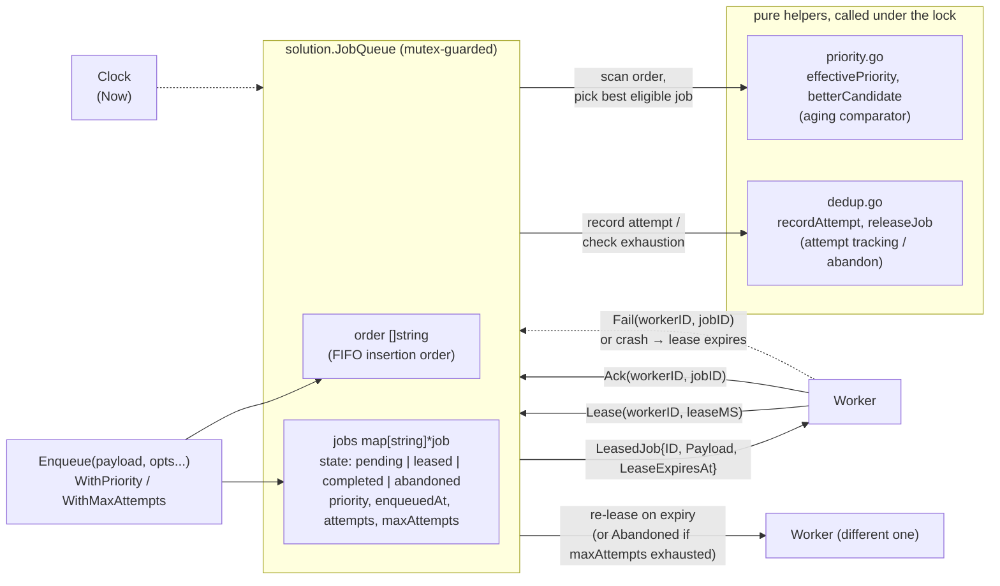

# YODOQ

Welcome to **Y**our **O**wn **D**on't-**D**rop **Q**ueue.

A small Go exercise: build a reliable job queue that doesn't lose work even when workers crash and acks vanish in transit. It doesn't compete with Sidekiq or Temporal — it's your own.

## Status

The reference solution in [`solution/`](solution/) is implemented and passes all three harness levels (`go run .`): zero jobs lost at every crash/ack-drop rate from 0% to 50%, with duplication bounded roughly linearly to the failure rate. It also implements the Concurrency, Priorities, Fairness, and Exactly-once-ish advanced challenges — see "Advanced challenges" below.

It's a single-process, in-memory `JobQueue`:

- A `sync.Mutex`-guarded `map[string]*job` plus an `order []string` slice for FIFO insertion-order scanning
- Each job tracks state (`pending` / `leased` / `completed` / `abandoned`), its current lease holder, lease-expiry time, priority, enqueue time, and attempt count
- `Lease` scans `order` and picks the best eligible job by *effective* priority (base priority minus wait-time-based aging, floored at `PriorityHigh`), tie-breaking by insertion order — this degenerates to exactly "first pending-or-lease-expired job" when every job shares the same priority, which is always true for `main.go`
- `Ack`/`Fail` validate the caller still holds the current lease before mutating state; releasing a lease (via `Fail` or expiry) routes through an attempt-exhaustion check that can move a job to the terminal `abandoned` state instead of back to `pending`
- Time comes from the injected `Clock`, so the test harness can fast-forward past lease expiries without sleeping
- The whole design is proven race-free under many concurrent callers via `go test -race ./...` (`solution/concurrency_test.go`)

## Getting started

You will implement a single-process, in-memory job queue with the following guarantees:

1. **Basic operations**: enqueue, lease, ack, fail
2. **Crash tolerance**: when a worker leases a job and dies, the job is eventually re-leased to someone else
3. **Bounded duplication**: under increasing crash + dropped-ack rates, the queue never *loses* work and keeps duplicate executions reasonably bounded

YODOQ ships with a test harness that runs three levels of escalating failure injection and grades how reliable your queue actually is.

## Architecture

- **`solution.JobQueue`** (`solution/queue.go`): core type and operations — `New`, `Enqueue`, `Lease`, `Ack`, `Fail`, `Stats`
- **`solution.EnqueueOption` / `solution.QueueOption`** (`solution/options.go`): functional options — `WithPriority`, `WithMaxAttempts` on `Enqueue`; `WithAgingIntervalMS` on `New`. All default to today's behavior when omitted
- **Priority & aging** (`solution/priority.go`): `Priority` levels (`PriorityHigh` / `PriorityNormal` / `PriorityLow`) and the effective-priority/aging comparator `Lease` uses to pick the best eligible job
- **Attempt tracking & dedup** (`solution/dedup.go`): per-job attempt counting and the Leased→Pending/Abandoned decision made whenever a lease is released (expiry or `Fail`)
- **`solution.Clock`**: abstraction over `time.Now()` so the harness can fast-forward
- **`Worker`** (`main.go`): virtual job consumer that may crash mid-process or have its acks dropped
- **`FailureSimulator`** (`main.go`): parameterizes crash and ack-drop rates
- **`ExecutionLedger`** (`main.go`): out-of-band ground truth of how many times each job *actually* ran — the harness's source of truth for grading
- **`TestHarness`** (`main.go`): three levels of tests



`Lease` scans `order`, scores every job that is `pending` (or `leased` with an expired `leaseExpiresAt`) by its *effective* priority at `now` — base priority minus wait-time-based aging, floored at `PriorityHigh` — and hands out the best-scoring one, tie-breaking by insertion order. This is exactly today's "first eligible job" behavior whenever every job shares the same priority, so a crashed worker's job still becomes re-leasable without any explicit failure signal; a job that has exhausted its `WithMaxAttempts` cap is abandoned instead of re-leased.

## Implementation Levels

### Level 1: Basic queue operations

- Implement `Enqueue`, `Lease`, `Ack`, `Fail`, `Stats`
- Acked jobs must not be re-leased
- Failed jobs must be re-leased
- Acks from a worker who no longer holds the lease (e.g. lease expired) must be rejected

### Level 2: Crash recovery

- When a worker leases a job and never acks (because it "crashed"), the queue must re-lease it after the lease expires
- Run with 20% crash rate — every job must run *at least once*
- No jobs lost forever

### Level 3: Reliability under stress

- Sweep crash + dropped-ack rates from 0.1% to 50%
- Goal: zero lost jobs, with duplicate-execution count bounded by the failure rate (not unbounded)

## Prerequisites

- Go 1.22+

## Running the tests

```bash
go run .
```

## Test results — what to look at

- **Jobs lost**: count of jobs whose processing function never completed. **This must be 0**. A queue that loses work is not a queue.
- **Excess executions**: count of duplicate runs (a job that ran 3 times contributes 2 excess). Should grow roughly linearly with failure rate, not exponentially.
- **Duplication rate**: total executions / job count − 1. A reasonable solution stays under ~2× the input failure rate.
- **Effective throughput**: how quickly the queue drains under failure.

## Success criteria

- Pass all Level 1 correctness tests
- Zero jobs lost at Level 2 (20% crash rate)
- Zero jobs lost across all Level 3 failure rates (up to 50%)
- Duplication remains bounded — pathological solutions can run a single job hundreds of times

## Advanced challenges

Once you have a working solution, consider:

- **Exactly-once-ish** — implemented: `WithMaxAttempts(k)` on `Enqueue` bounds how many times a job can be (re-)leased; once the `k`-th lease is given up without an intervening `Ack`, the job moves to a new terminal `Abandoned` state instead of back to `Pending`, surfaced via `Stats().Abandoned`. This bounds *leases*, not *executions* — the honest guarantee the queue can actually make. See `solution/dedup.go` and `solution/options.go`.
- **Priorities** — implemented: `WithPriority(p)` on `Enqueue` sets one of `PriorityHigh` / `PriorityNormal` / `PriorityLow`; `Lease` picks the best eligible job by *effective* priority, which ages toward `PriorityHigh` the longer a job waits (configurable via `WithAgingIntervalMS` on `New`), bounding worst-case starvation for low-priority jobs. See `solution/priority.go` and `Lease` in `solution/queue.go`.
- **Fairness** — implemented: worker fairness holds by construction (job selection in `Lease` never reads `workerID`, only queue state and `now`); retry fairness is bounded by lease-TTL pacing plus the opt-in max-attempts cap above. Both are exercised together in `solution/fairness_test.go`.
- **Concurrency** — implemented: the existing single-mutex design is proven race-free under many concurrent callers running `Enqueue`/`Lease`/`Ack`/`Fail`/`Stats` in `solution/concurrency_test.go` (`go test -race ./...`).
- **Persistence**: how would you survive a queue-process restart? What's the minimum on-disk footprint?
- **Observability** — implemented: a non-invasive `observer.Queue` wrapper publishes one event per call outcome (plus inferred lease-reclaim events) to a bus, served live over WebSocket to a terminal UI and a browser dashboard, without any change to `solution/queue.go`. See "Live observability tools" below.
- **Distributed, Kafka-like**: see [`docs/ai/kafka-comparison.md`](docs/ai/kafka-comparison.md) for what it would take to evolve this into a durable, partitioned, replicated log

## Live observability tools

A non-invasive observability layer sits beside `solution.JobQueue`, never inside it: `observer.Queue` (`observer/wrapper.go`) wraps a `*solution.JobQueue`, forwards every call unchanged, and publishes one `observer.Event` per call outcome (enqueue, lease granted, lease reclaimed after expiry, ack, fail, rejections, stats snapshots) to a bounded, non-blocking `observer.Bus` (`observer/bus.go`). Lease-reclaim is inferred purely from the wrapper's own call-sequence bookkeeping — `solution/queue.go` is untouched. Two binaries serve that event stream over one shared WebSocket protocol (`internal/wsserver`), and two independent clients consume it.

Each piece runs independently; both UI clients need one of the two servers already running.

- **`go run .`** — the original grading harness. Unaffected: same code path (now via `internal/harness`, extracted verbatim from `main.go`), same output.
- **`go run ./cmd/playground`** — interactive server. REST API (`POST /api/jobs`, `POST`/`DELETE /api/workers/{id}`, `GET /api/stats`, `POST /api/scenarios`, `POST /api/scenarios/{id}/replay`) plus a live WebSocket feed at `ws://localhost:8080/ws` (flags: `-addr`, `-backlog`).
- **`go run ./cmd/harness-replay`** — scripted replay. Runs the fixed Level 1/2/3 scenarios (identical literals/seeds to `go run .`) against a wrapped queue, serving the same protocol on `ws://localhost:8081/ws` (flags: `-addr`, `-backlog`, `-levels`, `-exit-after`).
- **`go run ./cmd/tui -addr=ws://localhost:8080/ws`** — terminal dashboard (bubbletea/bubbles/lipgloss). Connects to either server above; shows a connection-status header, the latest `stats_snapshot` counts, and a scrollable, color-coded event feed (lease reclaims in amber, rejections in red, time-to-expiry on lease rows).
- **`cd web && npm install && npm run dev`** — browser dashboard (React + TypeScript + Vite, its own `package.json`/toolchain, entirely separate from the Go module). Enter the server's `host:port` in the page (default `localhost:8080`) to connect; shows a stats strip with sparklines, an in-flight-leases table, and a filterable event feed.

New dependencies (`github.com/gorilla/websocket`, `github.com/charmbracelet/{bubbletea,bubbles,lipgloss}`) are confined to `cmd/playground`, `cmd/harness-replay`, `cmd/tui`, and `internal/wsserver` — `solution/`, `internal/harness`, and the root `main` package stay dependency-free.
