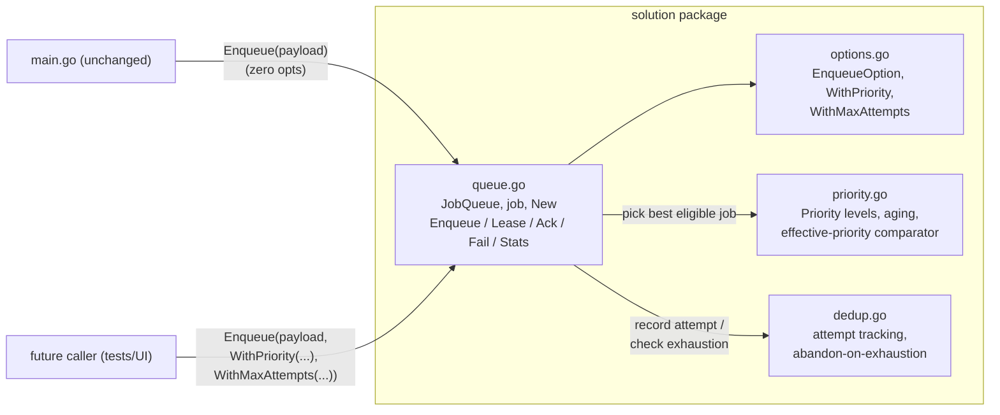
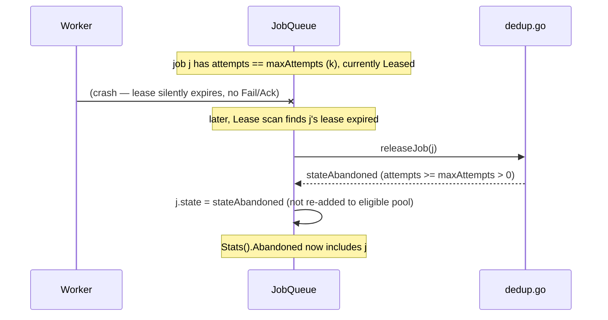

# Architecture: Advanced challenges — Priorities, Fairness, Exactly-once-ish
_Status: Proposed · Date: 2026-11-06 · Spec: ./spec.md_

## Context

This bolts three new behaviors onto `main`'s current, simple
`solution/queue.go` (single `sync.Mutex`, `map[string]*job`, `order
[]string` FIFO scan in `Lease`). It intentionally does **not** touch,
depend on, or reference the paused `feat/kafka-inspired-redesign` branch.
Everything here is designed to also work, unmodified in its public
surface, if that sharded redesign is adopted later — see "What this does
NOT change" below.



## Approach

1. **Enqueue extension via variadic functional options.** Add
   `opts ...EnqueueOption` to `Enqueue`. Every existing call site
   (`q.Enqueue([]byte(...))` in `main.go`, called with zero opts) keeps
   compiling and behaving identically, because the zero-value of every new
   per-job field (`priority`, `maxAttempts`) is chosen to mean "today's
   behavior" (`PriorityNormal`, "unlimited attempts"). This is simpler and
   more idiomatic Go than overloading with a second method or changing the
   parameter to a struct (which would force every call site to change).

2. **Priorities via an aging comparator, not separate per-level queues.**
   `Lease`'s scan stays a single pass over `order` (today's model already
   does this), but instead of "take the first eligible job," it computes
   each eligible job's *effective priority* at `now` and keeps the best
   candidate seen so far, tie-breaking by earliest insertion index. This
   needs no new container types, and — critically — degenerates to
   *exactly* today's "first eligible job in `order`" behavior whenever every
   job shares the same priority, which is always true for `main.go`'s
   jobs. See "Alternatives considered" for why a separate ready-queue-per-
   level design was rejected.

3. **Exactly-once-ish via an opt-in, per-job max-lease-count.** The queue
   can only observe leases, not executions (a crashed worker leaves no
   trace). So "a job can never run more than `K` times" is implemented
   honestly as "a job can never be *leased* more than `K` times" — each
   lease upper-bounds at most one execution, so bounding leases is a sound
   (if slightly conservative) way to bound executions. This is opt-in via
   `WithMaxAttempts`; omitting it preserves today's unlimited-retry
   behavior exactly, which is required for `main.go`'s existing levels to
   keep passing unchanged.

## Alternatives considered

1. **Separate ready-queue per priority level (3 slices/heaps) + weighted
   round-robin scheduler.** Classic approach (e.g. "serve 4 High : 2 Normal
   : 1 Low" credit scheme). Rejected as the primary mechanism because: (a)
   it requires maintaining three parallel ordered structures plus a
   rotation-state machine, more new state and more edge cases (what if a
   level is empty — skip or stall the rotation?) than a single-scan
   comparator; (b) it does not cleanly degenerate to today's exact
   behavior when all jobs are the same priority — the rotation state still
   exists and must be special-cased to behave like plain FIFO, whereas the
   aging-comparator approach needs no special case, the math just reduces
   to identical decay for every job; (c) today's `Lease` is already an
   O(n) scan with no secondary index, so avoiding a scan isn't a real
   win at this project's scale — the paused Kafka-inspired redesign is the
   correct place to revisit `Lease`'s algorithmic complexity, not this task.
   Weighted round-robin remains a reasonable *future* choice if the aging
   constants ever prove hard to tune; noted as a fallback, not adopted now.

2. **Separate `EnqueuePriority(payload, p)` / `EnqueueWithOptions(...)`
   method instead of variadic options on `Enqueue`.** Rejected: it would
   work (and also keep `main.go` compiling), but functional options are
   the idiomatic Go pattern for "one required arg, N optional ones," and
   composes better once `WithMaxAttempts` is added too (two independent
   optional knobs on one call, not two different methods to keep in sync).

3. **Make `Stats.Abandoned` an error return from `Lease`/a separate
   `DeadLetter()` accessor instead of a `Stats` field.** Rejected: a new
   exported method is a bigger, less discoverable surface than one new
   struct field, and `Stats` is already the established "read the current
   state of the world" surface; adding a field there is the smallest,
   most consistent change. Confirmed safe because `main.go` only ever
   reads named fields off the `Stats` value returned by `q.Stats()` — it
   never constructs a `Stats{}` literal and never enumerates its fields
   (checked in `main.go:124-131`, `301-324`, `380-392`).

## Components

### `solution/queue.go` (core — modified, not rewritten)
- **Responsibility**: the public types and the four core operations;
  orchestrates calls into `priority.go`/`dedup.go`/`options.go` but
  contains no priority-math or attempt-bookkeeping logic itself.
- **Changes**:
  - `job` struct gains three fields: `priority Priority`, `enqueuedAt
    int64` (ms, from `clock.Now()` at enqueue time — needed for aging),
    `attempts int`, `maxAttempts int` (0 = unlimited).
  - `jobState` gains `stateAbandoned`.
  - `Stats` struct gains `Abandoned int`.
  - `Enqueue(payload []byte, opts ...EnqueueOption) (string, error)`:
    resolves `opts` via `resolveOptions` (in `options.go`) into priority +
    maxAttempts, stamps `enqueuedAt = q.clock.Now()`, otherwise unchanged.
  - `Lease`: replaces "return the first eligible job" with "scan all
    eligible jobs, keep the best by `priority.Compare` (see below), return
    that one"; when assigning a lease, calls `dedup.recordAttempt(j)`
    (increments `attempts`).
  - `Fail`, and the lease-expiry branch inside `Lease`'s scan, both route
    the Leased→Pending transition through `dedup.releaseJob(j)`, which
    returns `statePending` or `stateAbandoned` depending on whether the
    job has exhausted `maxAttempts`.
  - `Stats`: adds a `case stateAbandoned: s.Abandoned++`.
- **Public interface delta**:
  ```go
  func (q *JobQueue) Enqueue(payload []byte, opts ...EnqueueOption) (string, error)
  type Stats struct {
      Pending   int
      Leased    int
      Completed int
      Abandoned int // new
  }
  ```

### `solution/options.go` (new)
- **Responsibility**: the `Enqueue` functional-options surface — the one
  place both Priorities and Exactly-once-ish extend the public API, kept
  separate from `queue.go` so the core file doesn't grow with every new
  optional knob.
- **Contents**:
  ```go
  type EnqueueOption func(*enqueueOptions)

  type enqueueOptions struct {
      priority    Priority // defaults to PriorityNormal
      maxAttempts int      // defaults to 0 (unlimited)
  }

  func WithPriority(p Priority) EnqueueOption
  func WithMaxAttempts(k int) EnqueueOption // k <= 0 is a no-op (unlimited)

  func resolveOptions(opts ...EnqueueOption) enqueueOptions
  ```

### `solution/priority.go` (new)
- **Responsibility**: priority levels and the aging/effective-priority
  math used by `Lease` to pick the best eligible candidate. No knowledge
  of leases, attempts, or job state transitions — pure functions over
  `(priority, enqueuedAt, now)`.
- **Contents**:
  ```go
  type Priority int
  const (
      PriorityHigh   Priority = 0
      PriorityNormal Priority = 1
      PriorityLow    Priority = 2
  )

  // agingIntervalMS controls the anti-starvation rate: every agingIntervalMS
  // of wait time reduces a job's effective priority value by 1 (i.e. makes
  // it more urgent), floored at PriorityHigh.
  const agingIntervalMS int64 = 2000

  // effectivePriority returns the job's priority as of now, after aging.
  func effectivePriority(basePriority Priority, enqueuedAt, now int64) int

  // betterCandidate reports whether candidate c should replace the current
  // best (best may be nil for "no candidate yet"). Lower effectivePriority
  // wins; ties broken by earlier insertion index (orderIdx).
  func betterCandidate(best *candidate, c candidate) bool

  type candidate struct {
      jobID            string
      orderIdx         int
      effectivePriority int
  }
  ```
- `Lease` calls `effectivePriority` for every eligible job in its existing
  scan and folds candidates through `betterCandidate`, then leases the
  winner. This preserves the single-pass, single-mutex, O(n) shape of
  today's `Lease` — no new container, no new lock.

**Anti-starvation guarantee (concrete):** with 3 levels (`High`=0,
`Normal`=1, `Low`=2) and `agingIntervalMS=2000`, a `Low` job's effective
priority reaches `0` (equal to a *freshly enqueued* `High` job) after at
most `2 * agingIntervalMS` = 4000ms of waiting, and from that point on it
wins every tie against same-effective-priority jobs enqueued *after* it
(earlier `orderIdx` wins ties). So: **a pending `Low` job is guaranteed to
be offered by `Lease` within 4 seconds of wait time plus however long it
takes to drain whatever was already strictly ahead of it at that moment**
— a fixed, documented bound, independent of how much new `High` work
keeps arriving afterward. This is the concrete anti-starvation mechanism
FR-3 requires.

### `solution/dedup.go` (new)
- **Responsibility**: the exactly-once-ish / max-attempts bookkeeping —
  recording a lease attempt and deciding, on release (expiry or `Fail`),
  whether the job goes back to `Pending` or becomes `Abandoned`. No
  knowledge of priority or the `order` scan.
- **Contents**:
  ```go
  // recordAttempt increments the job's attempt counter. Called by Lease
  // exactly once, at the moment a lease is handed out.
  func recordAttempt(j *job)

  // releaseJob decides the post-release state for a job whose lease is
  // being given up (expired or explicitly Failed). Returns statePending
  // if the job may still be retried, or stateAbandoned if it has hit
  // maxAttempts (maxAttempts <= 0 means unlimited: always statePending).
  func releaseJob(j *job) jobState
  ```
- **Honesty note (FR-8), restated in code comments on `releaseJob`**: this
  bounds *leases*, not *executions*. A worker that is leased and crashes
  before recording execution still consumes an attempt; a worker that
  successfully runs the job but whose `Ack` is dropped also still consumes
  an attempt on the next (unnecessary) re-lease. The bound is therefore on
  "how many times this job can possibly be handed to a worker," which
  upper-bounds — but may slightly over-count relative to — actual runs.
  This is the correct, honest interpretation given what the queue can
  observe (see spec FR-8).

**Memory trade-off (FR-12):** each `job` gains two `int` fields
(`attempts`, `maxAttempts`), `enqueuedAt int64`, and `priority Priority`
(an `int`-sized type) — 4 extra machine words, 32 bytes on a 64-bit
platform, per in-flight job, regardless of whether `WithMaxAttempts`/
`WithPriority` are ever used (the fields exist unconditionally on `job`
since Go has no cheap "optional field"). At 1,000,000 concurrently
in-flight jobs (far beyond this project's harness, which runs 200 jobs per
level), that is ~32MB of extra RAM — negligible next to typical job
payload sizes, and zero *additional* allocations (no new per-job map/slice
entries; the fields live inline in the existing `job` struct already
pointed to from `q.jobs`). The real cost is not memory but the small
constant-time per-lease comparison in `priority.go`'s `effectivePriority`
call, which does not change `Lease`'s big-O.

## Data model

No persistence, no migrations (persistence is explicitly out of scope).
In-memory `job` struct (updated):

```go
type job struct {
    id             string
    payload        []byte
    state          jobState // + stateAbandoned
    leaseWorker    string
    leaseExpiresAt int64

    priority    Priority // new
    enqueuedAt  int64    // new — ms, from clock.Now() at Enqueue time
    attempts    int      // new — count of leases handed out so far
    maxAttempts int      // new — 0 = unlimited
}
```

Backward compatibility: `job` is internal (lowercase), so this is not a
public API change. `Stats` gains one new exported field (`Abandoned`),
additive-only — see FR-10/Alternatives §3 for why this is safe.

## Interfaces / APIs

```go
// options.go
type Priority int
const (
    PriorityHigh   Priority = 0
    PriorityNormal Priority = 1
    PriorityLow    Priority = 2
)

type EnqueueOption func(*enqueueOptions)

func WithPriority(p Priority) EnqueueOption
func WithMaxAttempts(k int) EnqueueOption

// queue.go
func (q *JobQueue) Enqueue(payload []byte, opts ...EnqueueOption) (string, error)

type Stats struct {
    Pending   int
    Leased    int
    Completed int
    Abandoned int
}
```

No changes to `Lease`, `Ack`, `Fail`, `New`, `Clock`, `LeasedJob` function
signatures. Error cases are unchanged: `Ack`/`Fail` on a job that is
`stateAbandoned` return the same "worker does not hold the current lease
for this job" error they already return for any non-`stateLeased` job —
no new error type needed; `stateAbandoned` is simply one more state that
fails the existing `j.state != stateLeased` check.

## Key flows

### Priority-aware lease selection
```mermaid
sequenceDiagram
    participant W as Worker
    participant Q as JobQueue.Lease
    participant P as priority.go

    W->>Q: Lease(workerID, leaseMS)
    Q->>Q: now := clock.Now()
    loop for id in order
        Q->>Q: j := jobs[id]; eligible? (pending, or leased+expired)
        alt eligible
            Q->>P: effectivePriority(j.priority, j.enqueuedAt, now)
            P-->>Q: score
            Q->>P: betterCandidate(best, {id, idx, score})
            P-->>Q: keep best or replace
        end
    end
    Q->>Q: assign lease to best candidate (if any)
    Q->>Q: dedup.recordAttempt(best job)
    Q-->>W: LeasedJob{...} or nil
```

### Max-attempts exhaustion → Abandoned


## Cross-cutting

- **Errors**: no new error types; `Abandoned` jobs fail `Ack`/`Fail` with
  the existing "does not hold the current lease" error, which is accurate
  (they're not leased).
- **Logging**: none added — this package has no logging today and adding
  any would be scope creep beyond what the three challenges ask for.
- **Config**: `agingIntervalMS` is a package-level constant, not a runtime
  config knob — the spec doesn't require tunability, and adding a
  configuration surface (e.g. a `JobQueue` constructor option) for one
  constant would be premature; it can be promoted to a field later if a
  real need appears.
- **Security**: none — no new trust boundary, no new input beyond an
  `int`/enum the caller already controls via options.
- **Performance**: `Lease` stays O(n) per call (same as today — the
  aging-comparator work is O(1) per candidate inside the existing scan);
  no regression, no improvement; see "Alternatives considered" §1 for why
  a more clever structure is deliberately deferred to the paused redesign.
- **Concurrency**: unchanged — still one `sync.Mutex` over all of `q`'s
  state. All new fields (`priority`, `enqueuedAt`, `attempts`,
  `maxAttempts`) live inside `job`, which is already only ever touched
  under `q.mu`. FR-7's race test proves this holds.

## Test strategy

| Test | Type | Covers |
|---|---|---|
| `solution/concurrency_test.go` — many goroutines, `go test -race` | Unit/race | FR-7 (Concurrency) |
| `solution/priority_test.go` — mixed-priority ready set, no aging elapsed | Unit | FR-2, FR-3, FR-4 |
| `solution/priority_test.go` — sustained High load + one Low job, fake clock advanced | Unit | FR-3 (starvation bound), NFR-5 |
| `solution/priority_test.go` — all-default-priority jobs, order matches today | Unit (regression) | FR-4, NFR-3 |
| `solution/dedup_test.go` — `WithMaxAttempts(k)`, expire k times → Abandoned, `Stats().Abandoned` | Unit | FR-9, FR-10 |
| `solution/dedup_test.go` — no `WithMaxAttempts`, expire many times → stays Pending forever (unlimited) | Unit (regression) | FR-11, NFR-3 |
| `go run .` Levels 1–3 unchanged | Integration (existing harness) | NFR-3, overall regression |

Mapped FR coverage: FR-1 (compile-time, proven by `main.go` still building
— no dedicated test needed), FR-2–FR-4 and FR-5 above; FR-6 is argued, not
tested (see spec, "no new machinery" rationale) but implicitly covered by
the lease-TTL behavior already exercised in Levels 2/3; FR-8 is a doc/
comment requirement, not a test; FR-12 is a documented calculation, not a
test (an optional `go test -bench` memory note may be added but is not
required).

## Rollout & risk

- No feature flag needed — all new behavior is strictly additive and
  opt-in (`WithPriority`/`WithMaxAttempts` default to today's behavior).
  There is nothing to roll out gradually; `main.go` is unaffected by
  construction.
- **Risk**: a bug in `betterCandidate`'s tie-breaking could silently
  change Lease's order even for same-priority jobs, which would be a
  regression against NFR-3. Mitigated by the dedicated
  "all-default-priority" regression test and by running the full `go run
  .` harness as a gate before considering this done.
- **Risk**: choosing `agingIntervalMS` too large makes the starvation
  bound technically true but practically unhelpful (e.g. minutes instead
  of seconds); too small makes priority nearly meaningless under any
  sustained Low-priority trickle. `2000ms` is a starting constant chosen
  to be in the same order of magnitude as the harness's own lease
  durations (1000ms in `main.go`) and round-advance step (`clock.Advance(2000)`
  in `runUntilDrained`); it is not load-bearing for correctness, only for
  how aggressively aging kicks in, so it can be tuned later without
  changing the mechanism.
- **Rollback**: trivial — revert the four changed/added files; `main.go`
  and all existing behavior are untouched, so rollback has zero blast
  radius.

## Traceability

| FR/NFR | Component | Test |
|---|---|---|
| FR-1 | `queue.go` (`Enqueue` signature), `options.go` | compiles `main.go` unchanged |
| FR-2 | `priority.go` (`Priority` consts), `options.go` (`WithPriority` default) | priority_test.go (mixed-priority) |
| FR-3 | `priority.go` (`effectivePriority`, `agingIntervalMS`) | priority_test.go (starvation bound) |
| FR-4 | `priority.go` (`betterCandidate` tie-break) | priority_test.go (regression) |
| FR-5 | `queue.go` (`Lease` selection ignores `workerID`) | implicit in all priority/regression tests |
| FR-6 | n/a (argued, not built) | existing Level 2/3 harness |
| FR-7 | n/a (test-only) | concurrency_test.go |
| FR-8 | `dedup.go` doc comments | code review |
| FR-9 | `options.go` (`WithMaxAttempts`), `dedup.go` (`releaseJob`) | dedup_test.go |
| FR-10 | `queue.go` (`Stats.Abandoned`) | dedup_test.go |
| FR-11 | `dedup.go` (`maxAttempts <= 0` branch) | dedup_test.go (regression), `go run .` |
| FR-12 | doc comment / this file | memory calculation above |
| NFR-1..5 | repo-wide | `go build`, `go vet`, `gofmt -l`, full test suite, `go run .` |

## Decisions

- **ADR-1: Functional options on `Enqueue` over a new method.**
  Reason: idiomatic Go, composes for two independent optional knobs,
  zero changes to existing call sites. Consequence: any future third
  optional knob follows the same pattern instead of accumulating new
  method overloads.
- **ADR-2: Aging-comparator single-scan over per-level queues +
  round-robin.** Reason: simplest change that provably degenerates to
  today's exact FIFO behavior for uniform-priority input (required for
  NFR-3) and needs no new container/lock. Consequence: `Lease` stays
  O(n); if throughput at scale ever matters, that's the paused
  Kafka-inspired redesign's job, not this one — this design does not
  foreclose it.
- **ADR-3: Dedup window = bounded re-lease count, opt-in, default
  unlimited.** Reason: the queue cannot observe execution, only leasing,
  so bounding leases is the only honest implementation of "exactly-once-
  ish"; defaulting to unlimited is required so `main.go`'s existing
  levels (which never opt in) are provably unaffected. Consequence:
  callers who want the exactly-once-ish guarantee must explicitly state
  `K`; there is no implicit global dedup policy.
- **ADR-4: `Stats.Abandoned` as a new struct field, not a new method.**
  Reason: smallest additive change, consistent with existing `Stats`
  usage pattern, verified safe against `main.go`'s only read sites.
  Consequence: any future terminal/edge state can follow the same
  additive-field pattern.

## What this design does NOT change

- `Lease`/`Ack`/`Fail` semantics for non-priority, non-attempt-capped
  jobs — bit-for-bit identical to today.
- Lease-expiry-based crash recovery — still "scan for pending or
  lease-expired, hand it out," just now choosing the *best* such
  candidate instead of the *first*.
- The single global `sync.Mutex` concurrency model — this design adds
  fields to `job` and small pure helper functions; it does not introduce
  sharding, per-partition locks, or any concurrency-model change.
  **Adopting the paused sharded/Kafka-inspired redesign is a separate,
  later decision** — everything here (priority comparator, attempt
  bookkeeping) is expressed as logic over a single `job` record and a
  selection function over "the set of currently eligible jobs," which
  works whether that set comes from one global `order` slice (today) or
  from N per-partition structures (future): the comparator and
  attempt-release logic don't care where the candidate list comes from.
