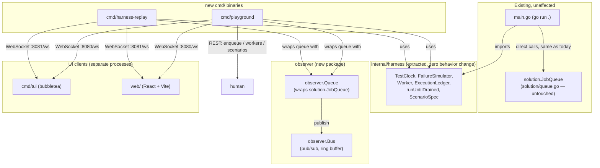
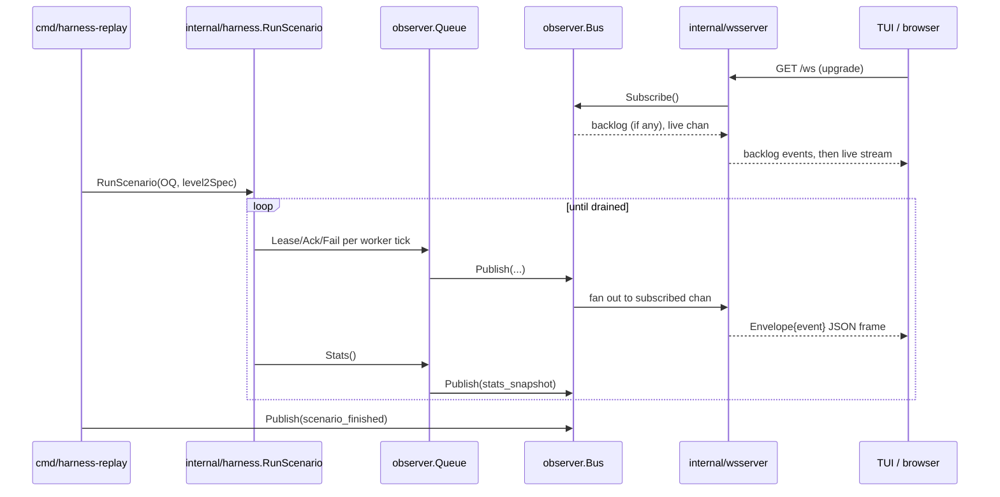
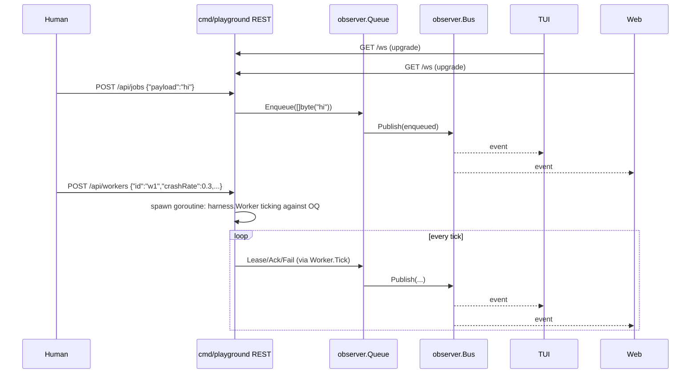

# Architecture: Live observability for YODOQ's JobQueue
_Status: Proposed · Date: 2026-11-06 · Spec: ./spec.md_

## Context

Today `main.go` talks directly to a concrete `*solution.JobQueue`. This
design adds an **observation layer that sits beside, never inside,** that
relationship: a wrapper that forwards calls and publishes events, plus two
new Go binaries and two UI clients that all consume the same event protocol.
Nothing here changes `solution/queue.go`, and `main.go` changes only in the
sense of importing an extracted-but-behaviorally-identical harness package.



Everything in `existing` keeps working with zero new dependencies and zero
behavior change. Everything in `obs`/`bins`/`clients` is additive.

## Approach

Three moving pieces:

1. **Extract, don't duplicate, the harness.** `main.go`'s simulation
   primitives move to `internal/harness` verbatim, with one generalization:
   `Worker.Queue` becomes an interface type (`harness.Queue`, the same five
   methods `solution.JobQueue` already has) instead of the concrete
   `*solution.JobQueue`. Since `*solution.JobQueue` already satisfies that
   interface structurally, `main.go` needs only an import change — no logic
   changes, so its output is provably unaffected. This interface is also
   exactly what lets `cmd/harness-replay` hand the *wrapped* queue
   (`*observer.Queue`, which also satisfies it) to the same `Worker`/
   `runUntilDrained` code, with no second implementation of the simulation
   logic anywhere.
2. **Wrap, don't modify, the queue.** `observer.Queue` embeds a
   `*solution.JobQueue`, forwards every call, and publishes one `Event` per
   call outcome (plus a derived "lease reclaimed" event — see below) to an
   in-process `observer.Bus`. The bus fans out to any number of subscribers
   (local Go channels) without ever blocking the caller.
3. **One wire protocol, two servers, two clients.** `cmd/playground` and
   `cmd/harness-replay` both expose the identical `/ws` JSON-event protocol
   (and `cmd/playground` additionally exposes a small REST API for the
   interactive bits). `cmd/tui` and `web/` are both pure WebSocket clients of
   that protocol — neither cares which server it's talking to, which is what
   lets either UI watch either mode.

## Alternatives considered

1. **Push events straight from `main.go`'s `Worker`/harness code instead of
   wrapping `JobQueue`.** Rejected: this is exactly the "UI concern leaking
   into the queue/harness" the brief explicitly rules out — it would mean
   every future caller of the queue (including `main.go` itself) carries
   observability code, and it would miss the explicit goal of proving the
   wrapper alone can infer lease-reclaim from the public API.
2. **In-process TUI only (no WebSocket), browser dashboard talks to a
   second, different protocol (e.g. SSE) for simplicity.** Rejected: the
   brief requires both UIs to watch *the same* live stream, and a TUI that
   can only observe its own process can't point at a remote/already-running
   playground server, which is a real use case (watch a long-running replay
   from a different terminal). One WebSocket protocol, two client
   implementations, is less total code than two protocols.
3. **A single `cmd/playground` binary with a `-mode=replay|interactive`
   flag instead of two binaries.** Considered seriously — it avoids a tiny
   amount of duplicated `main()`/flag-parsing boilerplate. Rejected in favor
   of two small binaries sharing an `internal/wsserver` helper (see
   Components) because the two modes have genuinely different lifecycles
   (replay is "run three fixed levels then idle/exit"; playground is
   "idle until a human drives it via REST, indefinitely") and separate
   `go run ./cmd/harness-replay` / `go run ./cmd/playground` commands read
   more clearly in the final "how do I run this" instructions than a flag a
   user has to know about. Either is valid; this doc picks two binaries.

## Components

### `internal/harness` (new package; logic moved from `main.go`, unchanged)
- Responsibility: the simulation engine — fake clock, failure injection,
  worker tick loop, ledger, and (new) a `ScenarioSpec` describing one
  parameterized run, all defined against an interface so either a raw or a
  wrapped queue can drive it.
- New/changed: new package; `main.go` shrinks to intro/section/logging
  helpers + `level1/2/3()` calling into `harness.*` types.
- Files: `internal/harness/harness.go` (moved `TestClock`,
  `ExecutionLedger`, `FailureSimulator`, `Worker`, `runUntilDrained`),
  `internal/harness/scenario.go` (new `ScenarioSpec` + `RunScenario`),
  `internal/harness/harness_test.go` (new).
- Public interface:
  ```go
  package harness

  // Queue is the subset of solution.JobQueue's API the simulation needs.
  // *solution.JobQueue and *observer.Queue both satisfy it structurally.
  type Queue interface {
      Enqueue(payload []byte) (string, error)
      Lease(workerID string, leaseMS int64) (*solution.LeasedJob, error)
      Ack(workerID, jobID string) error
      Fail(workerID, jobID string) error
      Stats() solution.Stats
  }

  type TestClock struct{ /* unchanged */ }
  type ExecutionLedger struct{ /* unchanged */ }
  type FailureSimulator struct{ /* unchanged */ }
  type Worker struct {
      ID       string
      Queue    Queue   // was *solution.JobQueue
      Clock    *TestClock
      Ledger   *ExecutionLedger
      Failures *FailureSimulator
      LeaseMS  int64
  }
  func RunUntilDrained(q Queue, clock *TestClock, workers []*Worker)

  // ScenarioSpec parameterizes one harness run (used by both the fixed
  // levels and the playground's "replay this" feature).
  type ScenarioSpec struct {
      Name             string
      Seed             int64
      JobCount         int
      WorkerCount      int
      LeaseMS          int64
      ProcessingTimeMS int64
      CrashRate        float64
      AckDropRate      float64
  }
  // RunScenario builds jobs/workers from spec, drains, returns the ledger
  // and the job IDs — exactly level2/level3's inner logic, generalized.
  func RunScenario(q Queue, spec ScenarioSpec) (*ExecutionLedger, []string)
  ```
- `main.go` after extraction (illustrative, not literal code — see plan.md
  T1): `level2()`/`level3()` build a `harness.ScenarioSpec{...}` matching
  today's literals exactly and call `harness.RunScenario`; `level1()` keeps
  its own inline step-by-step calls (it's testing specific transitions, not
  a bulk scenario) but against `q := solution.New(clock)` used as a
  `harness.Queue`-shaped value — no change to its assertions or printed
  output.

### `observer` (new package — the wrapper + bus; no HTTP/UI code here)
- Responsibility: event types, the pub/sub bus, and `observer.Queue`.
- Files: `observer/event.go`, `observer/bus.go`, `observer/wrapper.go`,
  plus `_test.go` files for each.
- Depends only on `yodoq/solution` and the stdlib (`sync`, `sync/atomic`,
  `time`) — **no HTTP/WebSocket/TUI dependency lives here**, so it stays
  importable by anything, including future test code, without pulling in
  `gorilla/websocket` or `bubbletea`.

#### Event model (`observer/event.go`)
```go
package observer

type Kind string

const (
    KindEnqueued             Kind = "enqueued"
    KindLeaseGranted         Kind = "lease_granted"
    KindLeaseReclaimed       Kind = "lease_reclaimed" // expiry, not Fail
    KindAck                  Kind = "ack"
    KindAckRejected          Kind = "ack_rejected"
    KindFail                 Kind = "fail"
    KindFailRejected         Kind = "fail_rejected"
    KindStatsSnapshot        Kind = "stats_snapshot"
    KindScenarioStarted      Kind = "scenario_started"
    KindScenarioFinished     Kind = "scenario_finished"
)

// Event is one observable happening. JSON field names are stable; new
// fields may be added over time (clients must ignore unknown fields —
// encoding/json already does this on decode).
type Event struct {
    Seq            uint64            `json:"seq"`            // bus-assigned, monotonic
    Kind           Kind              `json:"kind"`
    SimTimeMS      int64             `json:"simTimeMs"`      // from the queue's Clock
    WallTime       time.Time         `json:"wallTime"`        // for human-readable UI timestamps
    JobID          string            `json:"jobId,omitempty"`
    WorkerID       string            `json:"workerId,omitempty"`
    PrevWorkerID   string            `json:"prevWorkerId,omitempty"` // set on lease_reclaimed
    PayloadSize    int               `json:"payloadSize,omitempty"`
    LeaseExpiresAt int64             `json:"leaseExpiresAt,omitempty"`
    Err            string            `json:"err,omitempty"`  // set on *_rejected
    Stats          *solution.Stats   `json:"stats,omitempty"` // set on stats_snapshot
    ScenarioName   string            `json:"scenarioName,omitempty"`
    Meta           map[string]string `json:"meta,omitempty"` // open extension point
}

// Envelope is the wire message. "v" lets a client detect a future breaking
// change without every event needing it; absent a bump, clients just
// ignore fields they don't recognize.
type Envelope struct {
    V     int   `json:"v"` // currently 1
    Event Event `json:"event"`
}
```

#### Bus (`observer/bus.go`)
- Responsibility: assign `Seq`, keep a bounded backlog ring buffer (default
  500 events, configurable via `NewBus(backlog int)`) for late joiners
  (FR-10), and fan out to subscribers without blocking the publisher.
- Public interface:
  ```go
  type Bus struct { /* unexported: mu, seq, ring []Event, subs map[id]chan Event */ }
  func NewBus(backlogSize int) *Bus
  func (b *Bus) Publish(e Event)                 // never blocks; see policy below
  func (b *Bus) Subscribe() (id int64, ch <-chan Event, backlog []Event)
  func (b *Bus) Unsubscribe(id int64)
  ```
- **Backpressure policy: bounded per-subscriber channel (capacity 256),
  drop-newest on full.** When a subscriber's channel is full, the incoming
  event is discarded (not the oldest queued one) and a per-subscriber
  `Dropped` counter increments. Justification: (a) non-blocking is
  non-negotiable (NFR-4) — a stalled UI must never slow the queue; (b)
  drop-newest (vs. drop-oldest) preserves strict ordering of what *does*
  arrive, which matters more for a human reading a feed than guaranteeing
  the very latest event always displaces an old one; (c) a slow consumer
  self-heals: once it catches up, fresh events flow again, and the next
  `stats_snapshot` event (emitted on every `Stats()` call, which the
  harness and playground both call frequently) resynchronizes any UI that
  missed deltas, bounding how wrong a dropped-event UI can get.
- `Publish` itself: push to the ring buffer under one mutex, then for each
  subscriber do a non-blocking `select { case ch <- e: default: dropped++ }`.
  This is O(subscribers) per publish, which is fine at this scale (single
  digit UI clients).

#### Wrapper (`observer/wrapper.go`)
- Responsibility: the actual `observer.Queue` type with the lease-reclaim
  inference described in spec FR-1.
- Public interface (method-shape-identical to `solution.JobQueue`, per
  FR-2/NFR-1):
  ```go
  type Queue struct {
      inner *solution.JobQueue
      clock solution.Clock // same clock given to New, for SimTimeMS stamping
      bus   *Bus

      mu      sync.Mutex          // guards shadow below; NFR-3
      shadow  map[string]jobShadow
  }

  type jobShadow struct {
      lastWorker string
      state      string // "leased" | "acked" | "failed"
  }

  func Wrap(inner *solution.JobQueue, clock solution.Clock, bus *Bus) *Queue

  func (q *Queue) Enqueue(payload []byte) (string, error)
  func (q *Queue) Lease(workerID string, leaseMS int64) (*solution.LeasedJob, error)
  func (q *Queue) Ack(workerID, jobID string) error
  func (q *Queue) Fail(workerID, jobID string) error
  func (q *Queue) Stats() solution.Stats
  ```
- **Lease-reclaim inference** (the one subtle piece — done entirely at the
  wrapper boundary, no change to `solution/queue.go`):
  ```go
  func (q *Queue) Lease(workerID string, leaseMS int64) (*solution.LeasedJob, error) {
      lj, err := q.inner.Lease(workerID, leaseMS)
      if err != nil || lj == nil {
          return lj, err // nothing to publish; no job was available
      }
      q.mu.Lock()
      prev, seen := q.shadow[lj.ID]
      q.shadow[lj.ID] = jobShadow{lastWorker: workerID, state: "leased"}
      q.mu.Unlock()

      ev := Event{Kind: KindLeaseGranted, JobID: lj.ID, WorkerID: workerID,
          LeaseExpiresAt: lj.LeaseExpiresAt, PayloadSize: len(lj.Payload),
          SimTimeMS: q.clock.Now(), WallTime: time.Now()}
      // The ONLY way Lease returns a job ID the wrapper already has marked
      // "leased" (not "acked"/"failed") is that nobody at the public API
      // boundary released it — so the queue must have found an expired
      // lease and reclaimed it internally. That is observable purely from
      // call sequence, with no access to solution/queue.go internals.
      if seen && prev.state == "leased" {
          ev.Kind = KindLeaseReclaimed
          ev.PrevWorkerID = prev.lastWorker
      }
      q.bus.Publish(ev)
      return lj, nil
  }
  ```
  `Ack`/`Fail` mirror this: on success, set `shadow[jobID].state = "acked"`
  / `"failed"` *before* publishing, so the next `Lease` of that job ID is
  correctly classified as a fresh grant (post-explicit-release), not a
  reclaim. On failure (`err != nil`), publish `KindAckRejected`/
  `KindFailRejected` with `Err: err.Error()` and do not touch `shadow`
  (the state didn't change).
- `Stats()` forwards to `inner.Stats()` and always publishes
  `KindStatsSnapshot` with the result — this is the natural, already-present
  tap point, since both `main.go`'s `runUntilDrained` and the playground's
  polling loop already call `Stats()` every round.

### `cmd/playground` (new binary)
- Responsibility: interactive mode — REST API to enqueue jobs and
  start/stop simulated workers with live-set failure parameters, plus the
  WebSocket event stream.
- Files: `cmd/playground/main.go`, `cmd/playground/api.go`,
  `cmd/playground/server_test.go`.
- Depends on: `observer`, `internal/harness` (for `Worker`/`TestClock`-style
  simulated workers — the playground's "simulated worker" is literally a
  `harness.Worker` ticking in a goroutine loop against the wrapped queue,
  reusing the exact same crash/ack-drop logic as the fixed levels), and
  `github.com/gorilla/websocket` (new third-party dependency, confined to
  this binary and `cmd/tui`).
- REST surface (JSON in/out; binds `:8080` by default, flag-configurable):
  | Method & path | Body | Response | Errors |
  |---|---|---|---|
  | `POST /api/jobs` | `{"payload":"..."}` | `{"jobId":"job-7"}` | 400 invalid JSON |
  | `POST /api/workers` | `{"id":"w1","crashRate":0.2,"ackDropRate":0.0,"leaseMs":1000,"processingMs":100}` | `{"id":"w1"}` | 400 invalid params, 409 id already running |
  | `DELETE /api/workers/{id}` | — | 204 | 404 unknown id |
  | `GET /api/stats` | — | `solution.Stats` JSON | — |
  | `POST /api/scenarios` | `harness.ScenarioSpec` JSON | `{"scenarioRunId":"..."}` (runs it async, events stream over WS) | 400 invalid spec |
  | `POST /api/scenarios/{runId}/replay` | — | `{"scenarioRunId":"..."}` (new run, same spec, fresh queue — see Decisions D7) | 404 unknown runId |
  | `GET /ws` | — (upgrade) | event stream, see protocol below | — |
- Each running simulated worker is a goroutine looping
  `for { worker.Tick(); time.Sleep(tickInterval) }` against a shared
  `observer.Queue`; `tickInterval` is small (e.g. 50ms) since this is wall
  clock now, not a fast-forwarded fake clock (playground workers use a real
  `solution.Clock` backed by `time.Now()`, not `harness.TestClock`, because
  there's no "drain and stop" semantics in an open-ended interactive mode).

### `cmd/harness-replay` (new binary)
- Responsibility: replay mode — run the fixed Level 1/2/3 scenarios (via
  `internal/harness`, identical parameters to `main.go`) against a wrapped
  queue, serving the same WebSocket protocol, then idle (or exit, via
  `-exit-after` flag) so late-joining clients can still read the backlog.
- Files: `cmd/harness-replay/main.go`, `cmd/harness-replay/server_test.go`.
- Depends on: `observer`, `internal/harness`, `github.com/gorilla/websocket`.
- No REST API — it is a scripted run, not an interactive one. Flags:
  `-levels=1,2,3` (which to run, default all three), `-exit-after=false`.

### `internal/wsserver` (new tiny shared package, avoids duplicating ~40
lines of WS plumbing between the two binaries)
- Responsibility: given an `*observer.Bus`, expose a `http.Handler` that
  upgrades to WebSocket, sends the backlog, then streams `Envelope{V:1,
  Event: e}` JSON frames as events are published, until the client
  disconnects.
- Files: `internal/wsserver/wsserver.go`, `internal/wsserver/wsserver_test.go`.
- Public interface: `func Handler(bus *observer.Bus) http.Handler`.

### `cmd/tui` (new binary — WebSocket client, not in-process)
- Responsibility: terminal UI subscribing to a *remote* event stream over
  the same WebSocket protocol as the browser.
- Library choice: `github.com/charmbracelet/bubbletea` +
  `github.com/charmbracelet/bubbles` (viewport/table) +
  `github.com/charmbracelet/lipgloss` for styling — the standard,
  well-maintained Go TUI stack, pure Go, no CGO.
- **Design choice: WS client, not an in-process subscriber.** Rejected
  alternative: run the TUI inside `cmd/playground`/`cmd/harness-replay`
  itself, subscribing to the local `*observer.Bus` directly (zero network
  hop). That would be simpler for the single-process case, but fails the
  brief's requirement that the TUI and browser "watch the same live event
  stream" symmetrically, and specifically the implied need to point the
  TUI at an already-running, possibly separately-started, playground
  server. A WS client is the one design that is a client of *either*
  server, from *either* machine, exactly like the browser.
- Files: `cmd/tui/main.go`, `cmd/tui/model.go` (bubbletea `Model`:
  `Update`/`View`), `cmd/tui/client.go` (WS dial + reconnect-with-backoff).
  Flag: `-addr=ws://localhost:8080/ws` (points at playground by default;
  pass `:8081` to watch a replay run instead).
- View: a scrolling event log (bubbles `viewport`) plus a small header line
  with the latest `stats_snapshot` (`Pending/Leased/Completed`) — kept
  intentionally simple, matching the browser's "event feed + stat strip."

### `web/` (new, separate JS module — React + Vite)
- Responsibility: browser dashboard, WS client of the same protocol.
- Confirmed stack: React + TypeScript + Vite (`npm create vite@latest web --
  --template react-ts`), its own `web/package.json`, `web/vite.config.ts`,
  completely outside the Go module (Go tooling never looks inside `web/`;
  add `web/node_modules` and `web/dist` to `.gitignore`).
- Views (kept deliberately small, per spec Non-goals):
  1. **Event feed** — reverse-chronological list of recent `Event`s
     (virtualized list, e.g. plain windowed rendering — no extra dep
     needed at this scale), filterable by `kind`/`jobId`/`workerId` via a
     text input (client-side filter, no server query language needed).
  2. **Stats strip** — three numbers (Pending/Leased/Completed) updated on
     every `stats_snapshot`, plus a small sparkline per number over the
     last N snapshots (a tiny dependency-free `<svg>` polyline is enough;
     avoid pulling in a full charting library for three sparklines).
  3. **In-flight leases table** — derived client-side from the event
     stream (a job enters this table on `lease_granted`/`lease_reclaimed`,
     leaves on `ack`/`fail`), showing job ID, worker, and time-to-expiry
     (color goes amber/red as `leaseExpiresAt` approaches/passes, computed
     against the last-seen `simTimeMs`).
- State management: plain React hooks (`useReducer` over incoming
  `Envelope`s) — no Redux/Zustand needed for three views this size.
- Connects to `ws://<host>:<port>/ws` where host/port is a small input in
  the UI (default `localhost:8080`), so the same build can point at either
  `cmd/playground` or `cmd/harness-replay`.

## Data model

No database, no migrations (in-memory, matches `solution/queue.go`'s own
scope — NFR for persistence is explicitly out of scope). The only "schemas"
are the wire types above (`Event`, `Envelope`) and `harness.ScenarioSpec`.
Backward compatibility is handled by (a) never removing/renaming existing
JSON fields, (b) adding new fields as `omitempty`, and (c) the open `Meta
map[string]string` escape hatch for anything that doesn't warrant a new
top-level field yet.

## Interfaces / APIs

Already specified per-component above. Summary of error cases:
- `POST /api/jobs` with malformed JSON → `400 {"error":"..."}`.
- `POST /api/workers` with an `id` already running → `409`.
- `DELETE /api/workers/{id}` for unknown id → `404`.
- `POST /api/scenarios` with an invalid spec (e.g. `JobCount <= 0`) → `400`.
- `GET /ws` — a normal HTTP request (no `Upgrade` header) → `400` from the
  WS library; a client that disconnects is simply unsubscribed server-side
  (`Bus.Unsubscribe`), no error propagated anywhere else.

## Key flows

### Lease-reclaim inference (core trick, in-process, no HTTP involved)

```mermaid
sequenceDiagram
    participant Wk as Worker (harness, via wrapper)
    participant OQ as observer.Queue
    participant SQ as solution.JobQueue
    participant Bus as observer.Bus

    Wk->>OQ: Lease("w1", 1000)
    OQ->>SQ: Lease("w1", 1000)
    SQ-->>OQ: LeasedJob{ID:"job-5", ...}
    OQ->>OQ: shadow["job-5"] unseen -> state=leased(w1)
    OQ->>Bus: Publish(lease_granted, job-5, w1)
    OQ-->>Wk: LeasedJob{ID:"job-5"}

    Note over Wk,SQ: worker w1 crashes before Ack; lease expires inside SQ

    Wk->>OQ: Lease("w2", 1000)
    OQ->>SQ: Lease("w2", 1000)
    SQ-->>OQ: LeasedJob{ID:"job-5", ...}  (SQ reclaimed it internally)
    OQ->>OQ: shadow["job-5"] exists, state still "leased" -> this IS a reclaim
    OQ->>OQ: shadow["job-5"] = leased(w2); prevWorker=w1
    OQ->>Bus: Publish(lease_reclaimed, job-5, worker=w2, prevWorker=w1)
    OQ-->>Wk: LeasedJob{ID:"job-5"}
```

### Harness-replay: Level 2 streamed live



### Playground: interactive enqueue + simulated worker, watched by both UIs



## Cross-cutting

- **Errors**: REST errors are JSON `{"error": "..."}` with a 4xx status;
  queue-level errors (`Ack`/`Fail` rejection) are *not* HTTP errors — they
  are normal, expected outcomes published as `ack_rejected`/`fail_rejected`
  events, since a stale ack is a correct, graded scenario, not a bug.
- **Logging**: `cmd/playground`/`cmd/harness-replay` log server
  start/stop and WS connect/disconnect to stdout via the stdlib `log`
  package — no new logging dependency, consistent with the base repo
  having none today.
- **Config**: all server ports, backlog size, and tick interval are flags
  with sane defaults (`-addr=:8080`, `-backlog=500`, `-tick=50ms`) — no
  config file needed for a demo tool.
- **Security**: none beyond binding to `localhost` by default (NFR-7); CORS
  is wide open (`Access-Control-Allow-Origin: *`) since `web/`'s dev server
  (Vite, typically `:5173`) is a different origin than the Go server and
  this is a local tool, not a deployed service.
- **Performance**: `Bus.Publish` is O(subscribers) with a single mutex
  critical section per publish (ring-buffer append + per-subscriber
  non-blocking send); at the scale here (≤200 jobs, ≤~10 workers, single
  digit UI clients) this is microseconds, nowhere near a bottleneck versus
  `main.go`'s own `runUntilDrained` loop cap of 200,000 iterations.
- **Concurrency**: `observer.Queue`'s `shadow` map is guarded by its own
  `sync.Mutex`, independent of whatever locking `solution.JobQueue` uses
  internally (NFR-3) — this makes the wrapper correct under the
  playground's real concurrent goroutine workers regardless of which
  internal design the kafka-inspired-redesign task lands on, since the
  wrapper never reaches into `JobQueue` internals.
- **Determinism**: `cmd/harness-replay` uses `harness.TestClock` + seeded
  `*mrand.Rand` exactly as `main.go` does today (FR-3/FR-9) — same seed
  formula (`mrand.NewSource(42)` for level 2, `mrand.NewSource(int64(rate *
  10000))` per level-3 rate) — so its event sequence is reproducible run to
  run. `cmd/playground`'s ad hoc interactive actions are inherently
  non-deterministic (a human is driving), but FR-8 is satisfied via
  `POST /api/scenarios`: saving/replaying a `ScenarioSpec` (which *does*
  carry an explicit `Seed`) reruns deterministically against a fresh queue.

## Test strategy

- **Unit — `observer`**: `TestBus_PublishFanOutToAllSubscribers`,
  `TestBus_DropsNewestWhenSubscriberFull` (fills a subscriber's channel,
  asserts `Dropped` increments and ordering of what *does* arrive is
  preserved), `TestBus_BacklogDeliveredOnSubscribe`. `TestWrapper_FirstLeaseIsGranted`,
  `TestWrapper_ReLeaseAfterExplicitFailIsGranted`,
  `TestWrapper_ReLeaseAfterExpiryIsReclaimed` (drives a fake clock past
  expiry exactly like `solution`'s own tests, asserts `KindLeaseReclaimed`
  + correct `PrevWorkerID`), `TestWrapper_AckRejectedPublishesErrorEvent`,
  `TestWrapper_ConcurrentWorkersNoRace` (`-race`, covers NFR-3). Maps to
  FR-1, FR-2, NFR-3, NFR-4.
- **Unit — `internal/harness`**: `TestRunScenario_MatchesLevel2Literals`
  (build a `ScenarioSpec` with level 2's exact literals, assert
  `lost == 0` as `main.go` already informally checks) plus a **golden
  output test**: capture `go run .`'s stdout before and after the
  extraction refactor and diff byte-for-byte (covers FR-9/NFR-2 directly —
  this is the single most important regression test in the whole plan).
- **Integration — `cmd/playground`**: `httptest.NewServer` +
  `gorilla/websocket`'s dialer as a test client:
  `TestPlayground_EnqueueJobProducesEnqueuedEvent` (POST then read one WS
  frame), `TestPlayground_StartWorkerProducesLeaseEvents`,
  `TestPlayground_ScenarioReplayIsDeterministic` (run a scenario twice with
  the same seed, assert the two captured event sequences match modulo
  `WallTime`/`Seq`). Covers FR-4, FR-7, FR-8.
- **Integration — `cmd/harness-replay`**: `TestReplay_ThreeLevelsEmitExpectedEventCounts`
  (run with a short-lived test bus subscriber, assert at least one event of
  each taxonomy kind appears, and `scenario_finished` fires exactly 3
  times). Covers FR-3, FR-1.
- **e2e-ish (manual/CI-optional)**: `go run ./cmd/harness-replay -exit-after
  && go run .` — compare that both produce `lost == 0` for the same levels
  (they share `internal/harness`, so this is really re-confirming the
  extraction didn't drift). Not required in the base `go test ./...` run
  (no network/WS harness needed there) but documented in the plan.
- **Frontend**: out of scope for automated tests in this plan (a demo
  tool); `web/`'s own `npm run build` succeeding is the acceptance bar.
  `cmd/tui` similarly has no automated test beyond compiling — manual
  smoke test against a running server is the acceptance bar, documented in
  plan.md.

## Rollout & risk

- No feature flags needed — every new package/binary is additive; the base
  module (`solution`, `internal/harness` import aside, `main`) has no new
  external dependency, so `go build ./...`/`go test ./...` for the
  pre-existing scope stays dependency-free and fast.
- **Risk 1 — the `main.go` extraction regresses grading output.** This is
  the single highest-risk step in the whole plan (touches "fixed" code).
  Mitigated by: doing the extraction as a pure move (no logic rewrites),
  the golden-output byte-diff test above, and sequencing it as plan.md's
  very first, most heavily double-checked step before anything else is
  built on top of it.
- **Risk 2 — `observer.Bus`'s drop-newest policy silently hides events from
  a UI without the user noticing.** Mitigated by exposing a per-connection
  `Dropped` counter in the WS handshake response/first frame, so both UIs
  can show a small "N events dropped" indicator instead of silently
  under-reporting.
- **Risk 3 — the kafka-inspired-redesign task changes `JobQueue`'s
  internals in a way that breaks the lease-reclaim inference.** Not
  possible by construction: the inference only depends on the *public*
  return values of `Lease`/`Ack`/`Fail` and the wrapper's own call-sequence
  bookkeeping, never on `JobQueue`'s internal fields/locking/sharding —
  this is exactly why the spec and this design never reference that task's
  internals.
- **Risk 4 — two binaries (`cmd/playground`, `cmd/harness-replay`) drift in
  their WS framing over time.** Mitigated by both depending on the single
  shared `internal/wsserver.Handler`, so the framing code genuinely has one
  implementation, not two kept in sync by hand.
- No migration ordering concerns — nothing persists across runs (NFR
  non-goal), so there's no rollback step beyond "stop the new binaries";
  the base repo's `go run .`/`go test ./...` are unaffected regardless.

## Traceability

| FR/NFR | Component | Test |
|---|---|---|
| FR-1 (event taxonomy) | `observer/event.go`, `observer/wrapper.go` | `TestWrapper_*` suite |
| FR-2 (non-invasive wrapper) | `observer.Queue` embeds `*solution.JobQueue` unmodified | compiles against unmodified `solution/queue.go`; no wrapper test touches `solution` internals |
| FR-3 (harness-replay mode) | `cmd/harness-replay`, `internal/harness.RunScenario` | `TestReplay_ThreeLevelsEmitExpectedEventCounts` |
| FR-4 (interactive playground) | `cmd/playground` REST + simulated `harness.Worker` goroutines | `TestPlayground_StartWorkerProducesLeaseEvents` |
| FR-5 (two UIs, one stream) | `internal/wsserver.Handler` used by both servers; `cmd/tui` + `web/` both WS clients | integration tests hit the same handler from a test WS client |
| FR-6 (browser is a built JS app) | `web/` (Vite+React, own `package.json`) | `npm run build` succeeds |
| FR-7 (real TUI) | `cmd/tui` (bubbletea) | manual smoke test (plan.md) |
| FR-8 (repeatability) | `harness.ScenarioSpec` (seed) + `POST /api/scenarios/{id}/replay` | `TestPlayground_ScenarioReplayIsDeterministic` |
| FR-9 (zero behavior change extraction) | `internal/harness` | golden-output byte-diff test |
| FR-10 (late-join backlog) | `observer.Bus` ring buffer | `TestBus_BacklogDeliveredOnSubscribe` |
| NFR-1 (decoupling) | `solution/queue.go` untouched | code review / grep for imports |
| NFR-2 (harness unaffected) | `internal/harness` extraction | golden-output byte-diff test, `go run .` |
| NFR-3 (wrapper concurrency safety) | `observer.Queue.mu` | `TestWrapper_ConcurrentWorkersNoRace` (`-race`) |
| NFR-4 (non-blocking emission) | `observer.Bus` drop-newest policy | `TestBus_DropsNewestWhenSubscriberFull` |
| NFR-5 (toolchain isolation) | `web/` separate module; deps confined to `cmd/*` | `go list -m all` shows no new dep in `solution`/`internal/harness`/root `main` |
| NFR-6 (testability without UI) | `observer`, `internal/wsserver` unit/integration tests | whole test strategy section |
| NFR-7 (local-only scope) | default `localhost` bind, open CORS | documented, not enforced by a test |

## Decisions

- **D1 — Extract via an interface (`harness.Queue`), not a copy-paste
  duplicate of `main.go`'s types.** Reason: this is the only way
  `cmd/harness-replay` reuses the exact same simulation logic `main.go`
  uses without two codebases drifting. Consequence: `main.go`'s `Worker`
  field type changes from `*solution.JobQueue` to an interface — a
  signature generalization, not a behavior change, verified by the golden
  byte-diff test.
- **D2 — Two binaries (`cmd/playground`, `cmd/harness-replay`) sharing
  `internal/wsserver`, instead of one binary with a mode flag.** Reason:
  their lifecycles differ enough (open-ended interactive vs. run-three-
  levels-then-idle) that separate `main()`s read more clearly; the shared
  package keeps the actual WS plumbing from being duplicated. Consequence:
  slightly more `go build` targets, documented explicitly in plan.md's
  "how to run" section.
- **D3 — Drop-newest, bounded-per-subscriber-channel backpressure, with a
  visible `Dropped` counter.** Reason: see Cross-cutting/Risk 2; simplest
  policy that can never block the queue, with a visibility mitigation for
  its one downside (silently missing events).
- **D4 — `gorilla/websocket` for both the server side and the TUI client
  side.** Reason: it's the most widely used, stable Go WS library;
  reusing one library for both roles avoids learning two APIs for the same
  protocol. Consequence: a new direct dependency in `go.mod`, confined to
  `cmd/playground`, `cmd/harness-replay`, `cmd/tui`, and `internal/wsserver`
  — never in `solution`, `internal/harness`, or root `main` (NFR-5).
- **D5 — `bubbletea`/`bubbles`/`lipgloss` for the TUI, as a WebSocket
  client rather than an in-process subscriber.** Reason: see Components/
  `cmd/tui` — maximizes decoupling and lets the TUI watch a remote server.
  Consequence: the TUI needs a small reconnect-with-backoff loop (network
  can drop) that an in-process subscriber would never need; judged worth it
  for the flexibility gained.
- **D6 — Lease-reclaim inferred from wrapper-local call-sequence state, not
  from any `solution.JobQueue` internal.** Reason: required by NFR-1/FR-2;
  also makes the feature independent of the concurrently-evolving
  kafka-inspired-redesign task (Risk 3). Consequence: the wrapper carries a
  small amount of its own state (`shadow` map) that is, in effect, a
  redundant shadow of `JobQueue`'s own state machine — accepted as the
  necessary cost of staying fully external.
- **D7 — Scenario replay always starts a fresh `*solution.JobQueue`
  instance (never replays into the queue that's still running).** Reason:
  determinism (FR-8) requires starting from a known empty state — replaying
  into a queue with pre-existing jobs from earlier interactive poking would
  make the "structurally identical event sequence" guarantee meaningless.
  Consequence: `POST /api/scenarios/{id}/replay` is explicitly documented as
  "starts a new, isolated run," not "re-drives your current playground
  session" — flagged as an open question in spec.md in case a future
  developer wants the latter as an additional, separate feature.
