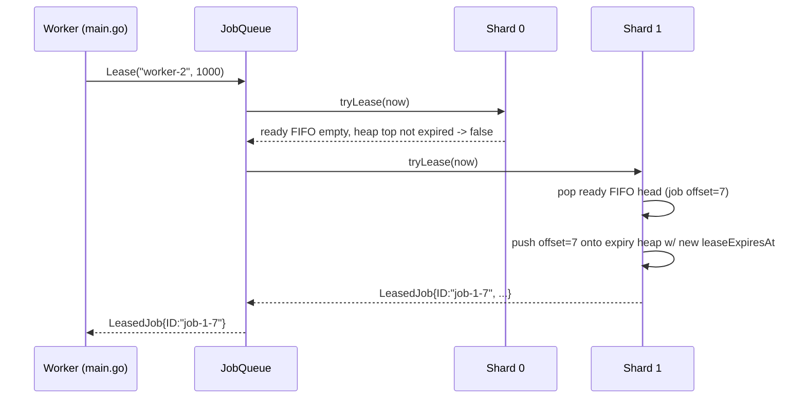

# Architecture: Sharded internal redesign of JobQueue
_Status: Proposed · Date: 2026-11-06 · Spec: ./spec.md_

## Context

`solution.JobQueue` is called in-process, synchronously, by `main.go`'s
test harness. Reading `main.go` confirms there is **no real concurrency**
today: `runUntilDrained` drives every `Worker.Tick()` from a single
goroutine in a plain loop, advancing a fake clock between rounds. So the
existing single `sync.Mutex` has zero contention in practice — the
motivation for this redesign is **algorithmic** (replace the O(n) scan in
`Lease`) and **defensive** (stay safe if a future/real caller is
concurrent), not relieving lock contention that doesn't exist yet.

```mermaid
flowchart LR
    subgraph main.go (fixed, unmodifiable)
        H[Worker.Tick / runUntilDrained]
    end
    H -- Enqueue/Lease/Ack/Fail/Stats --> Q[solution.JobQueue]
    subgraph JobQueue internals (this redesign)
        Q --> R[router: hash/round-robin job -> shard]
        R --> S0[Shard 0]
        R --> S1[Shard 1]
        R --> SN[Shard N-1]
        S0 --- D0[(ready FIFO + expiry min-heap + job table)]
        S1 --- D1[(ready FIFO + expiry min-heap + job table)]
        SN --- DN[(ready FIFO + expiry min-heap + job table)]
    end
```

## Approach

Partition the job space into a small fixed number of **shards**
(`numShards = 16`, an internal `const`, not exported — `New(clock)`'s
signature can't change). Each shard is an independent unit with its own
mutex, its own job table, its own FIFO of ready (never-leased-or-failed)
job IDs, and its own min-heap of currently-leased jobs ordered by
`leaseExpiresAt`. `JobQueue` becomes a thin router over `numShards`
shards plus the shared `Clock`.

Job IDs encode their shard and a per-shard monotonic **offset**, e.g.
`job-<shard>-<offset>` (still an opaque string to `main.go`, which never
parses IDs — satisfies FR-2). This is the one deliberate choice that most
changes the shape of the code: addressing a job by
`(shard, offset)` instead of a flat string-keyed map means `Ack`/`Fail`
can parse the shard straight out of the ID and go directly to the right
shard's mutex and `map[int64]*job` (keyed by offset, not by string) — no
separate ID→shard lookup table (and therefore no extra lock) is needed.

`Enqueue` assigns shards round-robin via an atomic counter on `JobQueue`
(not hashed — there's no job key to hash on, and round-robin keeps shards
evenly loaded, which matters more than any ordering property here since
the queue never promised cross-job ordering guarantees beyond what the
existing `order []string` FIFO incidentally gave).

`Lease` no longer scans a global list. For a given shard, finding an
eligible job is:
1. Pop the shard's ready FIFO head if non-empty (an always-pending job) →
   O(1) amortized.
2. Else peek the shard's expiry min-heap top; if it's a `leased` job whose
   `leaseExpiresAt <= now`, pop and reuse it (reassign to the new worker)
   → O(log k) where k is this shard's current job count, not the whole
   queue's.
3. Else this shard has nothing ready right now.

`Lease` at the `JobQueue` level starts at a rotating shard index
(round-robin, so no shard is starved) and tries up to `numShards` shards
until one yields a job or all are empty, returning `(nil, nil)` only if
every shard was empty. Worst case this is `numShards` shard-local
O(log k) operations, i.e. **O(numShards · log(n/numShards))** instead of
today's **O(n)** — a constant-factor-bounded, sublinear improvement that
satisfies FR-7 regardless of how load is distributed.

## Alternatives considered

1. **Single global ready-FIFO + single global expiry-heap, no sharding.**
   Would already fix the O(n) scan (FR-7) with far less code — one mutex,
   one deque, one heap. Rejected as the *primary* design only because the
   task brief specifically asks to evaluate partitioning; kept as the
   fallback/simpler option. See Decisions — this is what we'd ship if
   sharding were judged not worth its complexity (see trade-off below).
2. **Full sharding with a separate ID→shard lookup map.** Lets job IDs
   stay an unstructured string (e.g. `fmt.Sprintf("job-%d", seq)` as
   today) and resolves shard by `hash(id) % numShards` via a lookup. Gives
   the same complexity wins but adds a second map that itself needs
   locking (or its own striping) for every `Ack`/`Fail`/`Enqueue`.
   Rejected: strictly more moving parts than encoding the shard in the ID
   itself, for no behavioral benefit, since `main.go` never inspects IDs.
3. **Lock-free structures (atomic CAS-based queues/skip lists) instead of
   per-shard mutexes.** Rejected: no measured contention exists to justify
   it (see Context), it's a large correctness-risk increase for stdlib-only
   Go, and per-shard mutexes already remove essentially all contention a
   real concurrent caller would create, since the number of shards can
   exceed the number of workers.

**Sharding's real trade-off, stated plainly:** given confirmed sequential
execution in the current harness, sharding buys no measured performance
win today — its value is (a) the complexity reduction from O(n) to
O(numShards·log k) regardless of load distribution, which alternative 1
already gives almost as well with one heap, and (b) genuine headroom if
`JobQueue` is ever driven concurrently. We recommend sharding anyway
(Decision D1) because the ID-encodes-shard-and-offset scheme is simple to
implement correctly and keeps `Ack`/`Fail` O(1) shard dispatch, but flag
alternative 1 as an acceptable, smaller-diff fallback if the developer
finds the heap/FIFO-per-shard bookkeeping error-prone under test.

## Components

### `JobQueue` (changed)
- Responsibility: public API surface (unchanged signatures), routing
  `Enqueue` round-robin and `Lease` round-robin-with-fallback across
  shards, aggregating `Stats`.
- Files: `solution/queue.go` (rewritten internals; same file, same
  package, same exported types).
- Public interface: **unchanged** — `New`, `Enqueue`, `Lease`, `Ack`,
  `Fail`, `Stats`, `LeasedJob`, `Stats`, `Clock`, exactly as today.
- New unexported fields: `shards [numShards]*shard`, `enqueueCursor
  atomic.Uint64` (or plain counter under a tiny mutex — see Decisions),
  `leaseCursor atomic.Uint64`.

### `shard` (new, unexported)
- Responsibility: owns one slice of the job space: its own mutex, job
  table, ready FIFO, expiry heap, and next-offset counter.
- Files: `solution/queue.go` (or split into `solution/shard.go` if the
  developer prefers; no package boundary change either way).
- Fields:
  ```go
  type shard struct {
      mu         sync.Mutex
      idx        int              // this shard's index, for ID formatting
      nextOffset int64            // monotonic per-shard "offset"
      jobs       map[int64]*job   // keyed by offset, not by string
      ready      []int64          // FIFO of pending offsets (queue via head index)
      readyHead  int              // index of next ready item (avoids O(n) slice shifting)
      leaseHeap  expiryHeap       // min-heap by leaseExpiresAt, see below
      pendingN, leasedN, completedN int // O(1) Stats bookkeeping
  }
  ```
- Public interface (package-internal only): `enqueue(payload []byte) (id
  string)`, `tryLease(workerID string, leaseMS, now int64) (*LeasedJob,
  bool)`, `ack(workerID string, offset int64) error`, `fail(workerID
  string, offset int64) error`, `stats() (pending, leased, completed int)`.

### `job` (changed)
- Responsibility: same as today (one job's mutable state), now keyed by
  `offset int64` instead of relying solely on a string map key, plus a
  `heapIndex int` field so the expiry heap's `container/heap` methods can
  support O(log k) removal if the developer later wants exact removal
  instead of lazy invalidation (see Decisions D3).
  ```go
  type job struct {
      offset         int64
      payload        []byte
      state          jobState // unchanged: pending/leased/completed
      leaseWorker    string
      leaseExpiresAt int64
      heapIndex      int // maintained by expiryHeap; -1 when not in heap
  }
  ```

### `expiryHeap` (new, unexported)
- Responsibility: `container/heap`-based min-heap of `*job` ordered by
  `leaseExpiresAt`, used only to find/reclaim expired leases without
  scanning.
- Files: `solution/queue.go` (or `solution/expiry_heap.go`).
- Public interface: standard `heap.Interface` (`Len`, `Less`, `Swap`,
  `Push`, `Pop`) plus nothing else — the shard calls `heap.Push`/`heap.Pop`
  directly.

## Data model

No schema/migration concerns (in-memory, no persistence — NFR-5). The
only "data model" change is the job-ID format:

- **Today**: `job-<global-sequence>`, looked up via `map[string]*job`.
- **Proposed**: `job-<shard-index>-<per-shard-offset>`, looked up via
  `shards[shardIndex].jobs[offset]` (`map[int64]*job`).

Backward compatibility: job IDs are opaque to `main.go` (never parsed,
never persisted across runs, never compared across process restarts —
there's no persistence in or out of scope) — the format change is
invisible to every caller. No migration path is needed because there is
no durable state to migrate (NFR-5); every run starts with an empty queue.

## Interfaces / APIs

All five exported methods keep their exact current signatures (FR-1).
Internal dispatch:

```go
func (q *JobQueue) Enqueue(payload []byte) (string, error) {
    shardIdx := int(q.enqueueCursor.Add(1)) % numShards
    id := q.shards[shardIdx].enqueue(payload) // "job-<shardIdx>-<offset>"
    return id, nil
}

func (q *JobQueue) Lease(workerID string, leaseMS int64) (*LeasedJob, error) {
    now := q.clock.Now()
    start := int(q.leaseCursor.Add(1)) % numShards
    for i := 0; i < numShards; i++ {
        idx := (start + i) % numShards
        if lj, ok := q.shards[idx].tryLease(workerID, leaseMS, now); ok {
            return lj, nil
        }
    }
    return nil, nil
}

func (q *JobQueue) Ack(workerID, jobID string) error {
    idx, offset, err := parseJobID(jobID)
    if err != nil { return err }
    return q.shards[idx].ack(workerID, offset)
}
// Fail mirrors Ack.

func (q *JobQueue) Stats() Stats {
    var s Stats
    for i := range q.shards {
        p, l, c := q.shards[i].stats() // each call takes/releases that shard's mutex
        s.Pending += p; s.Leased += l; s.Completed += c
    }
    return s
}
```

`parseJobID` error case: a malformed or out-of-range ID (shouldn't happen
given `main.go` only ever passes back IDs this package minted) returns the
same `"job not found"` error `Ack`/`Fail` already return for unknown IDs
today — no new error type, no behavior change visible to callers.

## Key flows

### Lease with an expired lease sitting in another shard



### Ack routes directly to the owning shard (no cross-shard lock)

```mermaid
sequenceDiagram
    participant W as Worker
    participant Q as JobQueue
    participant S1 as Shard 1
    W->>Q: Ack("worker-2", "job-1-7")
    Q->>Q: parseJobID -> (shard=1, offset=7)
    Q->>S1: ack("worker-2", 7)
    S1->>S1: lock; validate state==leased && leaseWorker=="worker-2"
    S1->>S1: state=completed; completedN++; leasedN--
    S1-->>Q: nil
    Q-->>W: nil
```

## Cross-cutting

- **Errors**: unchanged error strings/semantics for `Ack`/`Fail`
  ("job not found", "worker does not hold the current lease for this
  job") — same behavior, just dispatched to the right shard first.
- **Logging**: none today, none added — out of scope.
- **Config**: `numShards` is an internal `const` (e.g. `16`). Not exposed
  because `New(clock)`'s signature is fixed (FR-1); if the developer wants
  it tunable for benchmarking, make it a package-level `var` with a
  default, but never add it to `New`'s parameters.
- **Security**: no change — no new trust boundary, still an in-process
  library.
- **Performance**: `Lease` goes from O(n) to O(numShards · log(n/numShards))
  worst case; `Stats` goes from O(n) (full map iteration today) to
  O(numShards) (each shard keeps running counters). `Enqueue`/`Ack`/`Fail`
  stay O(1)/O(log k) respectively (heap push is O(log k) on `Enqueue` is
  unnecessary — new jobs go straight into the ready FIFO, not the heap;
  heap involvement starts only when a job is leased).
- **Concurrency**: per-shard `sync.Mutex`, no global lock at all after
  routing (NFR-3). `Stats()` takes each shard's lock one at a time, so it
  never holds more than one lock simultaneously — no lock-ordering
  deadlock risk since no code path ever holds two shard locks at once (a
  job's shard is fully determined by its ID; no operation spans two
  shards).
- **Determinism for tests**: round-robin cursors for `Enqueue`/`Lease` are
  deterministic given deterministic call order, so Level 1/2/3's behavior
  (pass/fail counts) stays reproducible run-to-run for a fixed RNG seed,
  same as today — sharding changes *which* job gets leased when multiple
  are eligible, not whether the harness's pass/fail assertions (lost==0,
  bounded excess) hold, since those assertions never depend on lease
  order.

## Test strategy

New unit tests live in `solution/queue_test.go` (new file; none exists
today — current validation is only `main.go`'s levels). Keep `main.go`
itself untouched (FR-1).

- **Unit — shard-local, covers FR-3/FR-5/FR-7**:
  - `TestShardTryLease_ReadyFIFOOrder` — enqueue N jobs, lease all, assert
    IDs returned in FIFO order within one shard.
  - `TestShardTryLease_ReclaimsExpiredLease` — lease a job, advance fake
    clock past `leaseExpiresAt`, lease again, assert same job ID comes
    back to a different worker.
  - `TestShardTryLease_DoesNotReclaimLiveLease` — lease a job, advance
    clock *not* past expiry, lease again on an otherwise-empty shard,
    assert `(nil, false)`.
  - `TestExpiryHeap_OrdersByExpiry` — push jobs with out-of-order
    expiries, pop, assert ascending order (covers FR-7's core data
    structure in isolation).
- **Unit — queue-level routing, covers FR-1/FR-2/FR-4/FR-6**:
  - `TestJobQueue_EnqueueDistributesAcrossShards` — enqueue `numShards*3`
    jobs, assert (via a test-only accessor or by parsing returned IDs)
    that every shard got some jobs — guards against a round-robin bug
    that sends everything to shard 0.
  - `TestJobQueue_AckWrongWorkerRejected`,
    `TestJobQueue_AckUnknownJobRejected` — same error-contract tests as
    today, now exercised through the shard-routing path.
  - `TestJobQueue_StatsAggregatesAcrossShards` — enqueue/lease/ack a mix
    of jobs landing in different shards (deterministic because round-robin
    is deterministic), assert `Stats()` sums correctly.
- **Integration — covers FR-5/NFR-2, reusing `main.go`'s own harness
  concepts but as a Go test instead of a printed report**:
  - `TestJobQueue_ZeroLossUnderCrashAndAckDrop` — a trimmed version of
    `main.go`'s Level 2/3 logic (fake clock, simulated crash/drop,
    `ExecutionLedger`-equivalent) driven as a table test over the same
    rate sweep (0.1%–50%), asserting `lost == 0` and
    `excess <= jobCount*rate*2` exactly as `main.go` already asserts
    informally. This exists so a regression is caught by `go test`
    without needing to eyeball `go run .` output.
  - `TestJobQueue_ConcurrentCallersSafe` (covers NFR-3) — spin up real
    goroutines (unlike `main.go`'s sequential harness) hammering
    `Enqueue`/`Lease`/`Ack`/`Fail` concurrently with `-race` enabled in CI;
    assert no race detector failures and final `Stats()` is internally
    consistent (`Pending+Leased+Completed == totalEnqueued`).
- **No change needed to `main.go`**, but every plan step re-runs
  `go run .` as the acceptance gate per NFR-4, since that's the actual
  grading harness.

## Rollout & risk

- No feature flag needed — single-process library, no deployed users
  mid-migration, and `go run .` is the only "production" consumer, which
  the plan (plan.md) keeps green at every step.
- No migration ordering concerns — no persisted state across runs.
- **Risk 1**: heap lazy-invalidation (stale entries left behind by
  `Ack`/`Fail` until they naturally bubble to the top) could in theory let
  the heap grow unboundedly if a shard receives leases but few expiries
  ever reach the top. Mitigated: every leased job gets exactly one heap
  entry, and that entry is popped exactly once (either reclaimed-as-expired
  or discarded-as-stale) — the heap's size is bounded by `leasedN`, never
  by total historical jobs. No unbounded growth.
- **Risk 2**: round-robin `Enqueue` across shards means a shard can
  temporarily hold zero jobs while another holds many if callers only
  enqueue a handful of jobs (e.g. Level 1's single-job tests) — `Lease`'s
  round-robin-with-fallback-to-all-shards (not just the "current" shard)
  already covers this; worst case is `numShards` wasted empty-shard checks
  for a nearly-empty queue, still O(numShards), a small constant.
- **Risk 3**: getting `parseJobID` wrong (e.g. off-by-one on shard index)
  would silently misroute `Ack`/`Fail` and look like "job not found" —
  mitigated by the unit tests above and by keeping the ID format
  dead simple (`fmt.Sprintf("job-%d-%d", shardIdx, offset)`,
  parsed with `fmt.Sscanf` or `strings.Cut` twice — no ambiguity since
  `shardIdx` and `offset` are both non-negative integers and `-` doesn't
  appear in either).

## Traceability

| FR/NFR | Component | Test |
|---|---|---|
| FR-1 (fixed public API) | `JobQueue` method signatures unchanged | compiles against unmodified `main.go`; all unit tests above call the public API only |
| FR-2 (opaque IDs) | `shard.enqueue`, `parseJobID` | `TestJobQueue_EnqueueDistributesAcrossShards` |
| FR-3 (atomic single-assignment lease) | `shard.tryLease` | `TestShardTryLease_ReadyFIFOOrder`, `TestShardTryLease_DoesNotReclaimLiveLease` |
| FR-4 (ownership validation) | `shard.ack`, `shard.fail` | `TestJobQueue_AckWrongWorkerRejected` |
| FR-5 (expired lease reclaim) | `shard.tryLease` + `expiryHeap` | `TestShardTryLease_ReclaimsExpiredLease`, `TestJobQueue_ZeroLossUnderCrashAndAckDrop` |
| FR-6 (accurate aggregate Stats) | `JobQueue.Stats`, per-shard counters | `TestJobQueue_StatsAggregatesAcrossShards` |
| FR-7 (sublinear Lease) | sharding + ready FIFO + `expiryHeap` | `TestExpiryHeap_OrdersByExpiry`; complexity argument in Approach |
| NFR-2 (0 loss, bounded dup) | whole design | `TestJobQueue_ZeroLossUnderCrashAndAckDrop`, existing `go run .` Levels 2/3 |
| NFR-3 (concurrency safety) | per-shard `sync.Mutex`, no cross-shard lock-holding | `TestJobQueue_ConcurrentCallersSafe` (with `-race`) |
| NFR-4 (incremental, always green) | staged plan.md | re-run `go run .` at every plan step |

## Decisions

- **D1 — Shard the queue (vs. single global FIFO+heap).** Reason: the
  task brief explicitly asks us to evaluate partitioned sharding, and
  encoding `(shard, offset)` in the job ID makes shard dispatch O(1) with
  no extra lookup structure, which keeps the added complexity small
  relative to its educational/future-proofing value. Consequence: slightly
  more code (a `shard` type, ID parsing) than the single-structure
  alternative; mitigated by thorough unit tests per shard in isolation.
- **D2 — `numShards = 16`, a package constant, not derived from
  `runtime.NumCPU()`.** Reason: determinism (same behavior on any
  machine/CI runner) matters more than adapting to core count for a queue
  this size (hundreds of jobs in the harness), and `New(clock)` has no
  parameter to thread a configurable value through anyway (FR-1).
  Consequence: if someone needs more parallelism later they edit one
  constant and recompile; no runtime tuning knob exists, which is fine
  given there is no deployment story for this exercise.
- **D3 — Lazy invalidation in the expiry heap instead of exact
  `heap.Remove` on Ack/Fail.** Reason: simpler to implement correctly
  (no need to track/update heap indices on every state change); the
  `job.heapIndex` field is still included so a future developer can
  upgrade to exact removal without changing the surrounding API if heap
  bloat ever becomes a measured problem. Consequence: a shard's heap can
  transiently hold stale entries for already-acked/failed jobs until they
  naturally reach the top and get discarded — bounded by `leasedN` as
  argued in Risk 1, not a correctness issue.
- **D4 — Ready-queue priority over expiry-heap reclaim in `tryLease`.**
  Reason: prefer giving out a never-attempted job before stealing back an
  abandoned one, which should reduce duplicate executions slightly
  relative to today's strict insertion-order scan (which interleaves the
  two). Consequence: behavior differs subtly from today's exact ordering,
  but no test (today's `main.go` or the new unit tests) depends on exact
  interleaving — only on "zero lost" and "bounded duplication," which this
  change can only help, not hurt.
- **D5 — Reject bounded dedup-eviction window (from the task brief's
  menu).** Reason: already captured in spec.md's Non-goals — current
  "remember every completed job forever" is what makes duplicate-ack
  rejection correct, and the harness has no long-running/retention need
  that would justify the eviction-safety trade-off.

## Addendum (2026-11-06): adapting T6-T8 for priority/aging/dedup

Between this document being written and T6 being resumed, a separate,
now-merged "advanced challenges" effort added `solution/options.go`
(`WithPriority`, `WithMaxAttempts`, `WithAgingIntervalMS`),
`solution/priority.go` (priority levels + an aging comparator used by
`Lease`), and `solution/dedup.go` (attempt tracking + a terminal
`Abandoned` state) directly on top of the *pre-T2* `queue.go` (global
mutex, O(n) scan), independently of this branch's T1-T5 work. Reconciling
the two required the following departures from the plan/approach above —
recorded here rather than rewriting the sections above, which still
describe the right mental model for the parts that didn't change.

- **Ready structure becomes per-priority, not a single FIFO.** A shard's
  pending jobs now live in `map[Priority]*readyQueue` (one FIFO per
  distinct `Priority` value actually in use) instead of one `ready
  []int64`. This is required because `effectivePriority` ages jobs at
  different rates depending on their *base* priority, so a single FIFO
  can no longer guarantee "the job to hand out next is at the front" —
  but the front of each same-base-priority bucket still is, because aging
  is monotonic in wait time: the longest-waiting job in a bucket always
  has the lowest (most urgent) score among that bucket, floored at
  `PriorityHigh`. This keeps selection O(distinct priorities in use), not
  O(n) — still sublinear, just no longer literally O(1).
- **`Lease` compares candidates across *all* shards every call, not
  round-robin-stop-at-first-ready.** `TestLeasePrefersHigherPriorityWithNoAgingElapsed`
  and `TestLeasePreservesFIFOForEqualPriority` (pinned before this
  redesign resumed) require that the *globally* best-by-effective-priority
  job is returned, tie-broken by *global* insertion order, regardless of
  which shard it landed in. The original Decision-era approach (first
  non-empty shard wins) can't satisfy that once jobs carry priority, so
  `Lease` now: (1) reclaims each shard's expired leases, (2) peeks (without
  popping) each shard's best candidate, (3) picks the global best by
  `effectivePriority` then a global monotonic `seq` (replacing the old
  per-queue `order`-slice index as the FIFO tie-break, since there's no
  single global slice anymore), (4) attempts to take exactly that job from
  its shard, retrying the whole peek if another concurrent `Lease` won the
  race for the same job. This costs O(numShards) peeks per `Lease` call
  (still independent of total job count n) in exchange for keeping the
  pre-existing fairness/priority guarantees byte-for-byte.
- **D3 (lazy heap invalidation) is superseded by T3/T4's actual code**,
  which already does exact `heap.Remove` via `job.heapIndex` on `Ack`/
  `Fail` (see `expiry_heap.go`/`shard.go`) — simpler to reason about given
  the per-shard heap is now also read by the peek-then-take path above,
  and avoids ever handing out a job the heap still "remembers" as leased.
- **`job.seq`** (new field, a global `atomic`-assigned counter on
  `JobQueue`) replaces the old order-slice-position tie-break, since
  offsets are now per-shard and no longer comparable across shards for
  ordering purposes.
- **`Stats` gains `Abandoned`**, aggregated the same way as
  `Pending`/`Leased`/`Completed` (one more O(1) per-shard counter).

Everything else in this document (shard ownership of its own mutex/job
table, `(shard, offset)`-encoded IDs, `parseJobID`, no code path ever
holding two shard locks at once, `numShards = 16` as an internal
constant) is unchanged and implemented as described.
